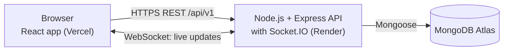
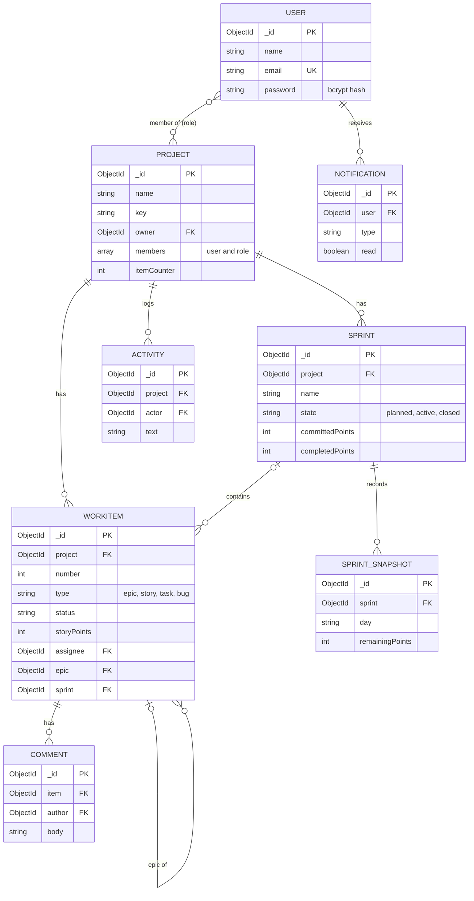

# Agile Project Management & Collaboration System (APMCS)

A web application where software teams plan sprints, track work on a Kanban board, discuss items and watch live progress charts. Several people can use the same project at once and see each other's changes instantly.

Built with the MERN stack (MongoDB, Express, React, Node.js) and Socket.IO as a final-year major project.

**Live demo:** https://apmcs-swart.vercel.app
The backend runs on a free tier that sleeps when idle, so the first load after a quiet period can take about a minute.

## Features

| Area | What you can do |
| --- | --- |
| Accounts | Register and log in; passwords are hashed and sessions use JWT |
| Projects and team | Create projects, add teammates by registered email, assign one of four roles, remove members or leave |
| Backlog | Create epics, stories, tasks and bugs with priority, story points, assignee and epic link; filter by type and sprint |
| Sprints | Create sprints with a goal and dates, move items in, start (one active at a time), complete with unfinished items going to the backlog or the next sprint |
| Kanban board | Drag cards between To do, In progress, In review and Done for the active sprint; progress bar shows points completed |
| Item panel | Edit details, discuss in comments, and get a warning if someone else changed the item while you were editing |
| Real time | Board, backlog, comments and team changes update live for everyone; see who is online |
| Notifications | A bell with unread count for assignments, status changes, comments, sprint start and completion, and team changes |
| Activity feed | A history of who did what in each project |
| Reports | Burndown chart (with ideal line and scope changes), velocity chart and workload per person |

## Roles

| Action | Product owner | Scrum master | Member | Viewer |
| --- | :---: | :---: | :---: | :---: |
| View project, board, reports | Yes | Yes | Yes | Yes |
| Create and edit items, comment, move cards | Yes | Yes | Yes | No |
| Create, start and complete sprints | Yes | Yes | No | No |
| Add members | Yes | Yes | No | No |
| Change roles | Yes | No | No | No |
| Remove members | Anyone | Members and viewers | No | No |
| Delete an item | Yes | Yes | Own items | No |

Anyone can leave a project, except its owner. People who are not members of a project cannot see that it exists.

## Architecture



- Every change goes through the REST API, where login, project membership and role checks are applied.
- Socket.IO only sends short notices ("something changed in this project"). Browsers then reload the affected data over REST, so the same permission checks cover everything.
- Notifications, activity lines and burndown snapshots are written by the API at the moment an action happens, so no background worker is needed.

## Data model



## Tech stack

| Layer | Technology |
| --- | --- |
| Frontend | React, Vite, React Router, dnd-kit (drag and drop), Recharts (charts), socket.io-client |
| Backend | Node.js 22, Express, Mongoose, Socket.IO |
| Database | MongoDB (Atlas) |
| Security | JWT, bcryptjs, Helmet, CORS allow-list, express-rate-limit |
| Testing | Node's built-in test runner, Supertest, mongodb-memory-server |
| Hosting | Vercel (frontend), Render (API), MongoDB Atlas (database) |

## Project structure

```
apmcs/
├── client/                  React app
│   └── src/
│       ├── components/      Board, Backlog, Sprints, Team, Reports, ItemModal, Activity, NotificationBell
│       ├── context/         AuthContext (who is logged in)
│       ├── pages/           Login, Register, Dashboard, ProjectDetail
│       └── services/        api.js, socket.js, timeAgo.js
└── server/                  Express API
    ├── scripts/             seedDemo.js, seedSnapshots.js
    ├── tests/               API tests
    └── src/
        ├── config/          database and environment checks
        ├── controllers/     business rules for each feature
        ├── middleware/      auth, project access, security, rate limits
        ├── models/          Mongoose schemas
        ├── routes/          URL addresses
        ├── sockets/         Socket.IO server and helpers
        └── utils/           activity, notifications, burndown snapshots
```

## Getting started

You need Node.js 22 or newer, Git, and a free MongoDB Atlas cluster (create a database user and allow your IP address under Network Access).

**1. Clone the repository**

```bash
git clone https://github.com/tKohinoor/apmcs.git
cd apmcs
```

**2. Start the API**

```bash
cd server
npm install
```

Create `server/.env` (copy `server/.env.example` and fill it in):

| Variable | Meaning |
| --- | --- |
| `MONGO_URI` | Atlas connection string, including a database name such as `/apmcs` |
| `JWT_SECRET` | A random string of at least 32 characters |
| `JWT_EXPIRES_IN` | Token lifetime, for example `7d` |
| `CLIENT_URL` | Address of the frontend, for example `http://localhost:5173` (no trailing slash) |
| `PORT` | Optional, defaults to 5000 |
| `REPORT_TIMEZONE` | Time zone used for burndown days, defaults to `Asia/Kolkata` |
| `TRUST_PROXY` | Set to `1` only when running behind a proxy such as Render |

Generate a secret with:

```bash
node -e "console.log(require('crypto').randomBytes(32).toString('hex'))"
```

Then run the API:

```bash
npm run dev
```

**3. Start the frontend** (in a second terminal)

```bash
cd client
npm install
```

Create `client/.env`:

```
VITE_API_URL=http://localhost:5000/api/v1
```

```bash
npm run dev
```

Open http://localhost:5173 and register an account.

## Useful commands

Run these inside `server/`.

| Command | What it does |
| --- | --- |
| `npm run dev` | Start the API and restart it when files change |
| `npm start` | Start the API (used in production) |
| `npm test` | Run the 70 API tests |
| `node --env-file=.env scripts/seedDemo.js --yes` | Load the demo project "Campus Event Portal" with five users, five sprints and about 36 items |
| `node --env-file=.env scripts/seedDemo.js --reset --yes` | Replace the demo data with a fresh copy (dates move to today) |
| `node --env-file=.env scripts/seedDemo.js --remove --yes` | Delete the demo users and their projects |

Running the seed script without `--yes` only shows which database it would change. It prints a random password for the demo accounts (`aarav@demo.apmcs.test`, `priya@...`, and so on) once, at the end. Demo accounts only ever touch users with a `@demo.apmcs.test` email.

## Testing

The API has 70 automated tests covering authentication, projects, roles, work items, sprints, comments, reports, notifications and security checks. They run against a temporary in-memory MongoDB, never your real database, and refuse to run on any database whose name does not end in `_test`.

```bash
cd server
npm test
```

The first run downloads a MongoDB binary and can take a few minutes. If the in-memory database cannot start on your computer, set `TEST_MONGO_URI` to a database whose name ends in `_test` and run again.

Rate limiting, live updates, drag and drop and the charts were checked by hand. There are no frontend or end-to-end tests yet.

## API overview

Base address: `/api/v1`. Everything except register, login and health needs a `Authorization: Bearer <token>` header.

| Area | Endpoints |
| --- | --- |
| Auth | `POST /auth/register`, `POST /auth/login`, `GET /auth/me` |
| Projects | `GET`, `POST /projects`; `GET /projects/:id` |
| Members | `POST /projects/:id/members`; `PATCH`, `DELETE /projects/:id/members/:userId` |
| Items | `GET`, `POST /projects/:id/items`; `GET`, `PATCH`, `DELETE /projects/:id/items/:itemId` |
| Comments | `GET`, `POST /projects/:id/items/:itemId/comments`; `DELETE .../comments/:commentId` |
| Sprints | `GET`, `POST /projects/:id/sprints`; `PATCH`, `DELETE /projects/:id/sprints/:sprintId`; `POST .../start`, `POST .../complete` |
| Reports | `GET /projects/:id/reports/burndown`, `/velocity`, `/workload` |
| Activity | `GET /projects/:id/activity?limit=` |
| Notifications | `GET /notifications`; `PATCH /notifications/:id/read`; `POST /notifications/read-all` |
| Health | `GET /health` |

## Security

- Passwords are hashed with bcrypt; they must have 8 or more characters with a letter and a number.
- Login is rate limited (10 failed attempts per 15 minutes per address), as are registration and the API as a whole.
- Every request checks login, project membership and role. People outside a project receive "not found".
- Requests containing MongoDB operator keys (`$` or `.`) are rejected, text fields must be real strings, and request bodies are limited to 100 KB.
- Unexpected errors are logged on the server; clients only see a generic message.
- The server refuses to start without `MONGO_URI`, `JWT_SECRET` (32+ characters) and `CLIENT_URL`.

## Deployment

| Part | Where | Notes |
| --- | --- | --- |
| Frontend | Vercel, root directory `client` | Set `VITE_API_URL` before building; `client/vercel.json` makes page refreshes work |
| API | Render web service, root directory `server` | Build `npm install --omit=dev`, start `npm start`, health check `/api/v1/health`; set the variables above with `TRUST_PROXY=1` and `NODE_VERSION=22` |
| Database | MongoDB Atlas | Use a separate database for production, for example `apmcs_prod` |

Both hosts rebuild automatically when `main` is pushed.

## Known limitations

- The login token is stored in the browser's localStorage and cannot be revoked before it expires.
- There is no password reset, email verification or email notification.
- The free Render tier sleeps when idle and restarts without warning; Atlas accepts connections from any address because Render's free outbound addresses are not fixed.
- Socket.IO assumes one server instance; several would need a shared adapter such as Redis.
- Not built: organizations and teams, @mentions, file attachments, labels, due dates, WIP limits, drag-to-reorder backlog, full-text search, cumulative flow chart, data export, stand-ups, retrospectives and chat.
- A failed item creation can leave a gap in item numbers.

## Team

- Kohinoor Tiwari 
- Karan Singh 
- Name 3
- Name 4
- Name 5
